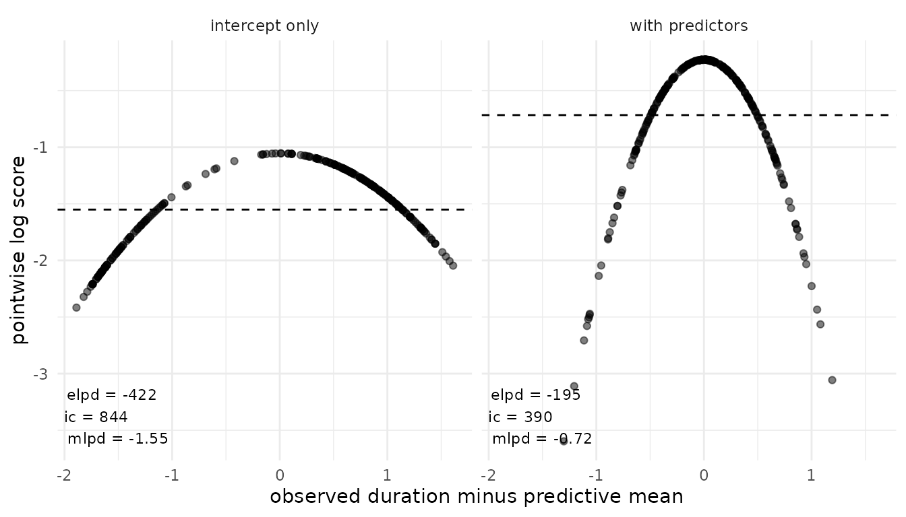
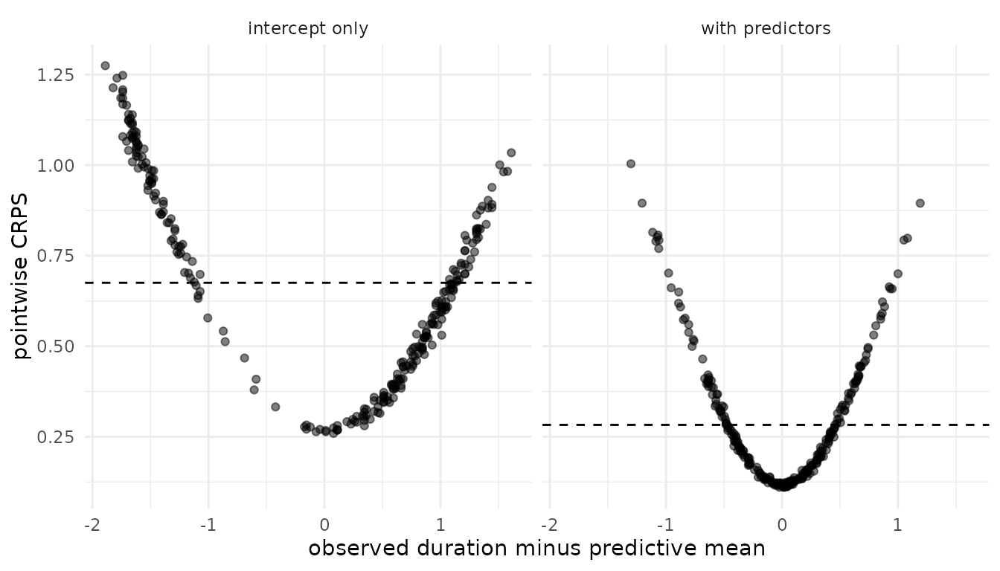
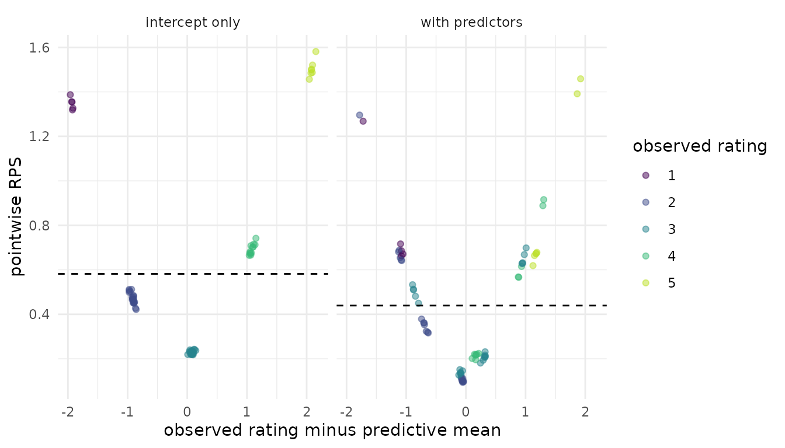
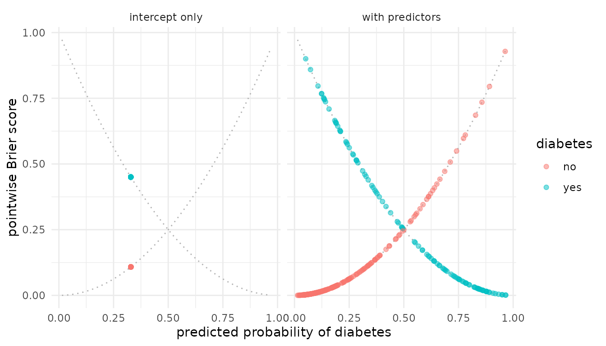
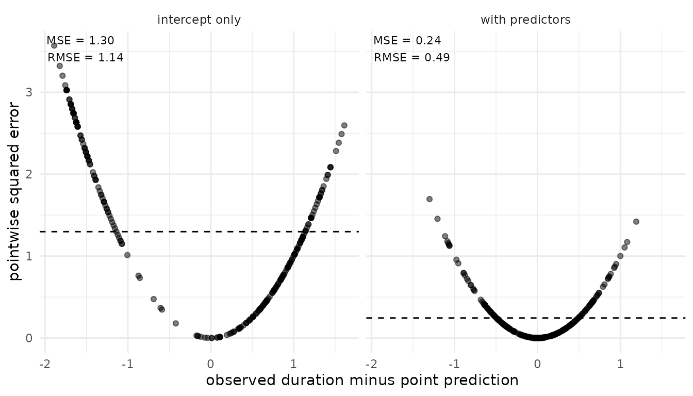
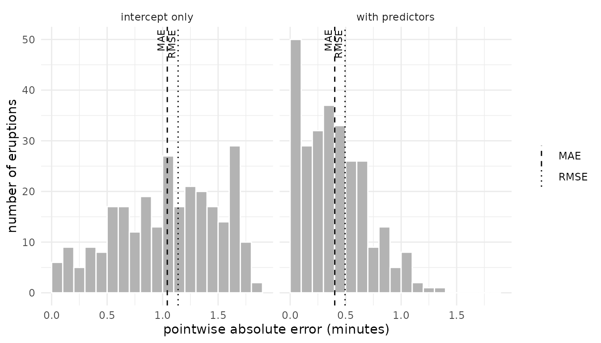
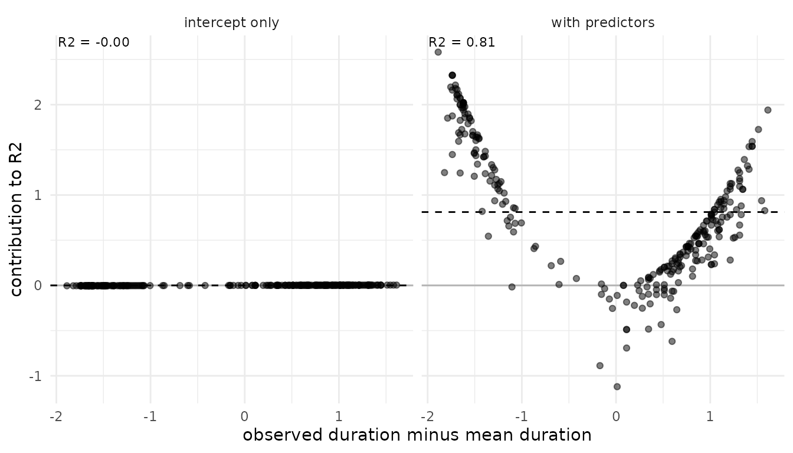
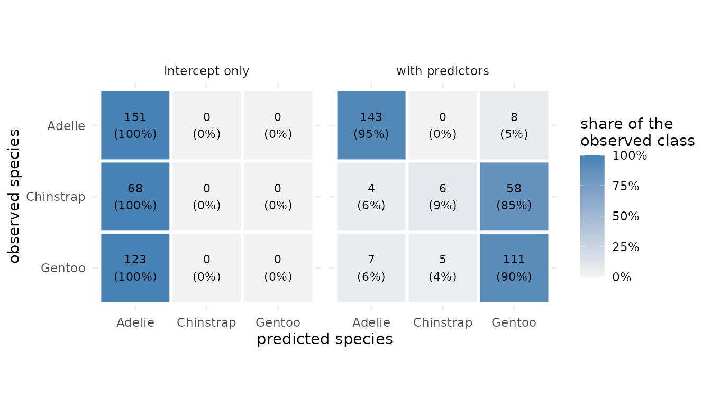

# Predictive model performance: Overview of measures

## Introduction

A *predictive measure* summarizes how well a model predicts data.
**loo** provides twelve built-in measures and the possibility to create
a custom measure. Each built-in measure has its own `measure_*()`
function.

This vignette introduces each built-in measure. For each measure it
gives:

1.  the motivation,
2.  when to use it,
3.  the key formula,
4.  the standard error,
5.  the implementation in **loo**, and
6.  a plot and its interpretation, comparing a model with predictors to
    an intercept-only model.

This vignette states only the key formulas. The full definitions, the
estimators, and the standard errors are in our supplement (Vehtari et
al., 2026).

This vignette hides the code for the plots. The full source code is in
the [`loo` GitHub
repository](https://github.com/stan-dev/loo/blob/master/vignettes/articles-online-only/overview-measures.Rmd).

**What this vignette does not cover**

- **Predictive schemes**
  - Examples in this vignette use in-sample predictions.
  - All measures can be used with leave-one-out, K-fold, or test-data
    predictions; see [Predictive model performance: Predictive schemes
    with
    `pred_measure()`](https://mc-stan.org/loo/pr/363/articles/articles-online-only/pred-measure-workflow.md).
- **Model comparison**
  - Using the
    [`model_compare()`](https://mc-stan.org/loo/pr/363/reference/model_compare.md)
    function; see [Model comparison: Explanation of
    `model_compare()`](https://mc-stan.org/loo/pr/363/articles/articles-online-only/model-comparison.md).
  - A tutorial on using model comparison within the Bayesian workflow;
    see [Model comparison: Case Study with
    `model_compare()`](https://mc-stan.org/loo/pr/363/articles/articles-online-only/)

## Overview of built-in measures

| Keyword | Measure | Family | Input | Outcome | Natural scale | Aggregation |
|:---|:---|:---|:---|:---|:---|:---|
| `elpd` | expected log pointwise predictive density | [log score](#log-score) | `ylp` | any | utility | sum |
| `mlpd` | mean log predictive density | [log score](#log-score) | `ylp` | any | utility | mean |
| `ic` | information criterion, \\-2\\\text{elpd}\\ | [log score](#log-score) | `ylp` | any | loss | sum |
| `rps` | (continuous) ranked probability score | [ranked probability score](#ranked-probability-score) | `ypred` | continuous or ordered | loss | mean |
| `srps` | scaled (continuous) ranked probability score | [ranked probability score](#ranked-probability-score) | `ypred` | continuous or ordered | utility | mean |
| `brier` | Brier score | [Brier score](#brier-score) | `ypred` | binary | loss | mean |
| `mae` | mean absolute error | [point error](#point-error) | `mupred` | continuous | loss | mean |
| `mse` | mean squared error | [point error](#point-error) | `mupred` | continuous | loss | mean |
| `rmse` | root mean squared error | [point error](#point-error) | `mupred` | continuous | loss | function of means |
| `r2` | predictive \\R^2\\ | [predictive \\R^2\\](#predictive-r2) | `mupred` | continuous | utility | function of means |
| `acc` | classification accuracy | [classification accuracy](#classification-accuracy) | `mupred` | binary or nominal | utility | mean |
| `bacc` | balanced accuracy | [classification accuracy](#classification-accuracy) | `mupred` | binary or nominal | utility | weighted sum |

The columns mean:

- **Natural scale:** A *loss* is better when it is lower. A *utility* is
  better when it is higher. `measure_*()` reports each measure on its
  natural scale.
- **Aggregation:** Most measures are a sum or a mean of pointwise terms.
  RMSE and \\R^2\\ have no pointwise terms that add up to the estimate.
  Balanced accuracy weights each pointwise term by its class, so that
  the terms sum to the estimate. For more details see Vehtari et
  al. (2026).

## Notation

This vignette uses one notation for all measures. The table maps each
symbol to an argument of `measure_*()` or to a field of its result.

| Symbol | Meaning | In **loo** |
|:---|:---|:---|
| \\y_i\\ | observed outcome \\i\\ | `y` |
| \\\theta^s\\ | posterior draw \\s\\, \\s = 1, \ldots, S\\ | rows of the input matrices |
| \\\ell_i^s = \log p(y_i \mid \theta^s)\\ | log density of \\y_i\\ under draw \\s\\ | `ylp`, an \\S \times n\\ matrix |
| \\\tilde y_i^s\\ | posterior predictive draw | `ypred`, an \\S \times n\\ matrix; for `brier`, the event probabilities \\p(\tilde y_i = 1 \mid \theta^s)\\ |
| \\\mathbb{E}\[\tilde y_i \mid \theta^s\]\\ | predictive mean under draw \\s\\ | `mupred`, an \\S \times n\\ matrix, or \\S \times n \times C\\ for \\C\\ classes |
| \\w_i^s\\ | normalized weight of draw \\s\\ (Vehtari et al., 2026, Eq. 2.5) | `log_weights`, on the log scale and unnormalized; **loo** normalizes them. `NULL` gives \\w_i^s = 1/S\\ |
| \\\text{elpd}\_i\\, \\\text{rps}\_i\\, \\\text{ae}\_i\\, … | pointwise term of a measure, on its natural scale | `$pointwise` |
| \\\widehat{\text{elpd}}\\, \\\widehat{\text{rps}}\\, \\\widehat{\text{mae}}\\, … | estimate of a measure | `$estimates[, "Estimate"]` |
| \\\widehat{\text{SE}}\\ | standard error of the estimate | `$estimates[, "SE"]` |
| \\\widehat{\text{Var}}\\ | sample variance over the observations |  |

**Weights**

Every estimator in this vignette uses weights \\w_i^s\\. With
`log_weights = NULL`, all draws get the weight \\1/S\\. This gives
in-sample predictions. Other weights give other predictive schemes, for
example PSIS-LOO.

## Data and models

``` r

library(loo)
library(brms)
library(ggplot2)
theme_set(theme_minimal())
```

For each outcome type we fit two `brms` models:

- **with predictors**: a model that uses the predictors of the data,
- **intercept only**: a model that predicts the same distribution for
  every observation.

The intercept-only model is a baseline. It shows how a measure changes
when a model uses no information from the predictors. The model with
predictors is better, but not necessarily good. Fitting is not the topic
of this vignette. The model code is in the
[appendix](#appendix-model-code).

| Object | Data | Outcome | Predictors | Used for |
|:---|:---|:---|:---|:---|
| `fits_cont` | `faithful` (`datasets`) | continuous, normal | `waiting` | log score, CRPS, point error\*, \\R^2\\ |
| `fits_bin` | `Pima.te` (`MASS`) | binary, Bernoulli | `glu`, `bmi`, `age` | Brier score |
| `fits_ord` | `wine` (`ordinal`) | ordered, 5 categories | `temp`, `contact` | RPS |
| `fits_cat` | `penguins` (`datasets`) | nominal, 3 unbalanced classes | `bill_len` | accuracy |

\*point error measures include MAE, MSE, and RMSE.

Each `fits_*` object is a list with the elements `"with predictors"` and
`"intercept only"`.

**Prediction tasks.** The models predict the following outcomes:

| Model | Outcome | Predictors | N |
|:---|:---|:---|:---|
| Eruption duration (`fits_cont`) | `eruptions`: duration of the eruption, in minutes | `waiting`: waiting time to the eruption, in minutes | 272 eruptions |
| Diabetes (`fits_bin`) | `diabetes`: 1 if the woman has diabetes (no: 223, yes: 109) | `glu`: plasma glucose concentration; `bmi`: body mass index; `age`: age in years | 332 women |
| Wine bitterness (`fits_ord`) | `rating`: bitterness of the wine, on an ordered scale from 1 to 5 (1: 5, 2: 22, 3: 26, 4: 12, 5: 7) | `temp`: temperature during the crushing of the grapes, cold or warm; `contact`: contact between juice and skins, no or yes | 72 ratings from 9 judges |
| Penguin species (`fits_cat`) | `species`: Adelie (151), Chinstrap (68), or Gentoo (123) | `bill_len`: bill length, in mm | 342 penguins |

## Log score

**Motivation.** The log score evaluates the predictive density at the
observed value. A model gets a high score when it puts much probability
near the observation. It uses the whole predictive distribution, and it
strongly penalizes observations the model considers very unlikely.

**When to use.** The log score works for any outcome type. It is the
default measure in **loo**. It needs the log-likelihood draws `ylp`.

**Key formula.** The pointwise term and the estimate are (Vehtari et
al., 2026, Eqs. 2.16–2.18)

\\ \text{elpd}\_i = \log \sum\_{s=1}^S \exp\\\left(\log w_i^s +
\ell_i^s\right), \qquad \widehat{\text{elpd}} = \sum\_{i=1}^n
\text{elpd}\_i . \\

**loo** reports two rescaled versions:

- \\\widehat{\text{mlpd}} = \widehat{\text{elpd}} / n\\ on the mean
  scale, and
- the information criterion \\\widehat{\text{ic}} =
  -2\\\widehat{\text{elpd}}\\.

**Standard error.** The elpd is a sum, the mlpd is a mean (Vehtari et
al., 2026, Eqs. 2.8, 2.9):

\\ \widehat{\text{SE}}(\widehat{\text{elpd}}) =
\sqrt{n\\\widehat{\text{Var}}(\text{elpd}\_i)}, \qquad
\widehat{\text{SE}}(\widehat{\text{mlpd}}) =
\sqrt{\widehat{\text{Var}}(\text{elpd}\_i) / n}, \qquad
\widehat{\text{SE}}(\widehat{\text{ic}}) =
2\\\widehat{\text{SE}}(\widehat{\text{elpd}}) . \\

**Implementation.**

``` r

ylp_cont <- lapply(fits_cont, brms::log_lik)
elpd_cont <- lapply(ylp_cont, function(ylp) measure_elpd(ylp = ylp))
mlpd_cont <- lapply(ylp_cont, function(ylp) measure_mlpd(ylp = ylp))
ic_cont <- lapply(ylp_cont, function(ylp) measure_ic(ylp = ylp))

# output structure of elpd measure for model with predictors
str(elpd_cont$`with predictors`)
#> List of 2
#>  $ estimates: num [1, 1:2] -195 10
#>   ..- attr(*, "dimnames")=List of 2
#>   .. ..$ : chr "elpd"
#>   .. ..$ : chr [1:2] "Estimate" "SE"
#>  $ pointwise: num [1:272, 1] -0.731 -0.57 -0.533 -0.8 -0.228 ...
#>   ..- attr(*, "dimnames")=List of 2
#>   .. ..$ : NULL
#>   .. ..$ : chr "elpd"
#>  - attr(*, "class")= chr [1:2] "measure" "loo"
#>  - attr(*, "measure")= chr "elpd"
#>  - attr(*, "dims")= int [1:2] 1000 272
```

**Plot.** The models `fits_cont` predict `eruptions`, the duration of
each of 272 eruptions of the Old Faithful geyser (`faithful` data). Each
point is one eruption. The x-axis shows the distance of the observed
duration from the predictive mean. The y-axis shows the pointwise log
score \\\text{elpd}\_i\\. The dashed line is the mlpd, the mean of the
points. Higher is better.



**Interpretation.** Both models predict a normal distribution, so the
points lie on a parabola. The intercept-only model predicts the same
wide distribution for every eruption. Its parabola is flat: no eruption
gets a very high or a very low score. The predictor `waiting` makes the
predictive distribution narrower. Eruptions close to the predictive mean
then get a higher score, and eruptions far from it get a lower score.
The log score drops with the square of the distance, so these few
eruptions pull the estimate down. The mlpd is -0.72 against -1.55.

## Ranked probability score

**Motivation.** The ranked probability score compares the predictive
distribution with the observed value through absolute distances. Unlike
the log score, it rewards predictions that are *close* to the
observation, not only predictions that hit it. It penalizes outlying
observations less than the log score, but it is not robust to them
(Bolin and Wallin, 2023).

**When to use.** Use `rps` for ordered categorical outcomes (RPS) and
for continuous outcomes (CRPS). It is on the scale of \\y\\, so a value
can be read in the units of the outcome. Use `srps` when outcomes differ
strongly in their predictive spread. Both need the posterior predictive
draws `ypred`.

**Key formula.** Let \\X\\ and \\X'\\ be independent draws from the
predictive distribution of observation \\i\\ (Vehtari et al., 2026, Eqs.
2.20-2.22):

\\ \text{rps}\_i = \mathbb{E}\|X - y_i\| - \tfrac{1}{2}\\\mathbb{E}\|X -
X'\|, \qquad \text{srps}\_i = -\frac{\mathbb{E}\|X -
y_i\|}{\mathbb{E}\|X - X'\|} - \tfrac{1}{2}\log \mathbb{E}\|X - X'\| .
\\

The estimates are the means \\\widehat{\text{rps}} = \frac{1}{n}\sum_i
\text{rps}\_i\\ and \\\widehat{\text{srps}} = \frac{1}{n}\sum_i
\text{srps}\_i\\. **loo** estimates both expectations from one set of
draws. The estimator of \\\mathbb{E}\|X - X'\|\\ is a
probability-weighted moment estimator (Vehtari et al., 2026, Eq. 2.25).
`rps` is a loss (lower is better), and `srps` is a utility (higher is
better).

For ordered outcomes, code the categories \\1, \ldots, K\\. Let \\F_i\\
be the predictive CDF of observation \\i\\. Then \\\text{rps}\_i =
\sum\_{k=1}^{K-1} \left(F_i(k) - \mathbb{1}\\y_i \le k\\\right)^2\\.
This is the RPS of Epstein (1969) without the factor \\1/(K-1)\\. Divide
by \\K-1\\ to get values between 0 and 1.

**Standard error.** Both are means (Vehtari et al., 2026, Eq. 2.8):

\\ \widehat{\text{SE}}(\widehat{\text{rps}}) =
\sqrt{\widehat{\text{Var}}(\text{rps}\_i) / n}, \qquad
\widehat{\text{SE}}(\widehat{\text{srps}}) =
\sqrt{\widehat{\text{Var}}(\text{srps}\_i) / n} . \\

**Implementation.** For the continuous outcome,
[`measure_rps()`](https://mc-stan.org/loo/pr/363/reference/measure_rps.md)
gives the CRPS and the SCRPS:

``` r

y_cont <- fits_cont[[1]]$data$eruptions
ypred_cont <- lapply(fits_cont, brms::posterior_predict)

crps_cont <- lapply(ypred_cont, function(yp) measure_rps(y = y_cont, ypred = yp))
scrps_cont <- lapply(ypred_cont, function(yp) measure_srps(y = y_cont, ypred = yp))

# output structure of crps measure for model with predictors
str(crps_cont$`with predictors`)
#> List of 2
#>  $ estimates: num [1, 1:2] 0.2827 0.0111
#>   ..- attr(*, "dimnames")=List of 2
#>   .. ..$ : chr "rps"
#>   .. ..$ : chr [1:2] "Estimate" "SE"
#>  $ pointwise: num [1:272, 1] 0.332 0.224 0.241 0.321 0.119 ...
#>   ..- attr(*, "dimnames")=List of 2
#>   .. ..$ : NULL
#>   .. ..$ : chr "rps"
#>  - attr(*, "class")= chr [1:2] "measure" "loo"
#>  - attr(*, "measure")= chr "rps"
#>  - attr(*, "dims")= int [1:2] 1000 272
```

For the ordered outcome, the same functions give the RPS and the SRPS:

``` r

y_ord <- as.integer(fits_ord[[1]]$data$rating)
ypred_ord <- lapply(fits_ord, brms::posterior_predict)

rps_ord <- lapply(ypred_ord, function(yp) measure_rps(y = y_ord, ypred = yp))
srps_ord <- lapply(ypred_ord, function(yp) measure_srps(y = y_ord, ypred = yp))

# output structure of srps measure for model with predictors
str(srps_ord$`with predictors`)
#> List of 2
#>  $ estimates: num [1, 1:2] -0.9333 0.0423
#>   ..- attr(*, "dimnames")=List of 2
#>   .. ..$ : chr "srps"
#>   .. ..$ : chr [1:2] "Estimate" "SE"
#>  $ pointwise: num [1:72, 1] -0.518 -1.288 -0.681 -1.414 -1.069 ...
#>   ..- attr(*, "dimnames")=List of 2
#>   .. ..$ : NULL
#>   .. ..$ : chr "srps"
#>  - attr(*, "class")= chr [1:2] "measure" "loo"
#>  - attr(*, "measure")= chr "srps"
#>  - attr(*, "dims")= int [1:2] 1000 72
```

**Plot.** The models `fits_cont` predict `eruptions`, the duration of
each of 272 eruptions of the Old Faithful geyser (`faithful` data). Each
point is one eruption. The x-axis shows the distance of the observed
duration from the predictive mean, as in the log score plot. The y-axis
shows the pointwise CRPS \\\text{rps}\_i\\, in minutes. The dashed line
is the estimate, the mean of the points. Lower is better.



**Interpretation.** In both panels the points form a V with a round
bottom. Far from the predictive mean, the CRPS grows about linearly with
the distance, like an absolute error. The log score, by contrast, drops
with the square of the distance. The narrower distribution of the model
with predictors moves the whole V down: even an exact hit gets a lower
CRPS. Its estimate is 0.28 against 0.68.

**Plot for the ordered outcome.** The models `fits_ord` predict
`rating`, the bitterness of a wine on a scale from 1 to 5. There are 72
ratings from 9 judges (`wine` data). Each point is one rating. The
x-axis shows the distance of the observed rating from the predictive
mean. The y-axis shows the pointwise RPS \\\text{rps}\_i\\. The color
shows the observed rating. The dashed line is the estimate. Lower is
better.



**Interpretation.** The intercept-only model gives every wine the same
predictive distribution. Its points therefore form five tight clusters,
one for each observed rating. The RPS uses the order of the categories:
a rating far from the predictive mean gets a higher RPS. The model with
predictors gives each combination of `temp` and `contact` its own
predictive distribution. Each spot therefore splits into smaller groups.
Most points move closer to zero distance, and together they form a V, as
for the CRPS. Its estimate is lower: 0.44 against 0.58.

## Brier score

**Motivation.** The Brier score is the squared distance between the
predicted probability of an event and the observed outcome, 0 or 1. It
rewards probabilities that are both calibrated and sharp, that is, close
to 0 or 1.

**When to use.** Use it for binary outcomes. **loo** implements the
binary Brier score only.
[`measure_brier()`](https://mc-stan.org/loo/pr/363/reference/measure_brier.md)
needs the event probabilities of the draws, passed as `ypred`.

**Key formula.** With the predicted event probability \\\hat p_i =
\sum_s w_i^s\\ p(\tilde y_i = 1 \mid \theta^s)\\ (Vehtari et al., 2026,
Eqs. 2.26–2.28),

\\ \text{bs}\_i = \left(\hat p_i - y_i\right)^2, \qquad
\widehat{\text{bs}} = \frac{1}{n}\sum\_{i=1}^n \text{bs}\_i . \\

The Brier score is a loss (lower is better). It ranges from 0 to 1.

**Standard error.** The Brier score is a mean (Vehtari et al., 2026, Eq.
2.8):

\\ \widehat{\text{SE}}(\widehat{\text{bs}}) =
\sqrt{\widehat{\text{Var}}(\text{bs}\_i) / n} . \\

**Implementation.**

``` r

y_bin <- fits_bin[[1]]$data$diabetes
p_bin <- lapply(fits_bin, brms::posterior_epred)
brier_bin <- lapply(p_bin, function(p) measure_brier(y = y_bin, ypred = p))

str(brier_bin$`with predictors`)
#> List of 2
#>  $ estimates: num [1, 1:2] 0.146 0.0117
#>   ..- attr(*, "dimnames")=List of 2
#>   .. ..$ : chr "brier"
#>   .. ..$ : chr [1:2] "Estimate" "SE"
#>  $ pointwise: num [1:332, 1] 0.07217 0.00343 0.00231 0.90024 0.00443 ...
#>   ..- attr(*, "dimnames")=List of 2
#>   .. ..$ : NULL
#>   .. ..$ : chr "brier"
#>  - attr(*, "class")= chr [1:2] "measure" "loo"
#>  - attr(*, "measure")= chr "brier"
#>  - attr(*, "dims")= int [1:2] 1000 332
```

**Plot.** The models `fits_bin` predict `diabetes`, 1 if the woman has
diabetes, for 332 women (`Pima.te` data). Each point is one woman. The
x-axis shows the predicted probability \\\hat p_i\\ of diabetes. Every
point lies on one of two curves: \\\hat p_i^2\\ if the woman has no
diabetes, and \\(1 - \hat p_i)^2\\ if she has diabetes. Lower is better.



**Interpretation.** The intercept-only model gives every woman the same
probability, the proportion of women with diabetes. All its points fall
on two spots, one on each curve. The model with predictors spreads the
probabilities. A woman moves down her curve when the model is confident
and right. She moves up her curve when the model is confident and wrong.
Most women without diabetes get a low probability and a score near 0. A
few women with diabetes get a low probability and a score up to 0.9. Its
estimate is lower: 0.15 against 0.22.

## Point error

**Motivation.** The point-error measures reduce the predictive
distribution to one point prediction, the predictive mean. They then
measure the distance between that prediction and the observed value.
They are easy to interpret, but they ignore the predictive uncertainty.

**When to use.** Use them for continuous outcomes when the quality of
the point prediction matters. MAE is less sensitive to large errors than
MSE and RMSE. MAE and RMSE are on the scale of \\y\\. All three need the
predictive means `mupred`.

**Which point prediction.** Each loss rewards a different point
prediction. The squared error is smallest in expectation for the
predictive mean. The absolute error is smallest for the predictive
median (Gneiting, 2011). **loo** uses the predictive mean for all three
measures. MSE and RMSE therefore evaluate the prediction they reward.
MAE evaluates the mean, not the median. In the normal model here, the
predictive distribution is close to symmetric. Its mean and its median
are then about equal.

**MAE or RMSE.** Neither is better in general. RMSE fits normal errors,
and MAE fits Laplace errors with heavier tails (Hodson, 2022). RMSE is
never smaller than MAE. They are equal only when all absolute errors are
equal.

**Key formula.** With the point prediction \\\hat y_i = \sum_s w_i^s\\
\mathbb{E}\[\tilde y_i \mid \theta^s\]\\, the pointwise errors are
\\\text{ae}\_i = \|y_i - \hat y_i\|\\ and \\\text{sqe}\_i = (y_i - \hat
y_i)^2\\ (Vehtari et al., 2026, Eqs. 2.29-2.34):

\\ \widehat{\text{mae}} = \frac{1}{n}\sum\_{i=1}^n \text{ae}\_i, \qquad
\widehat{\text{mse}} = \frac{1}{n}\sum\_{i=1}^n \text{sqe}\_i, \qquad
\widehat{\text{rmse}} = \sqrt{\widehat{\text{mse}}} . \\

All three are losses.

**Standard error.** MAE and MSE are means (Vehtari et al., 2026, Eq.
2.8). RMSE is a function of a mean, so its standard error uses the delta
method (Vehtari et al., 2026, Eq. 2.33):

\\ \widehat{\text{SE}}(\widehat{\text{mae}}) =
\sqrt{\widehat{\text{Var}}(\text{ae}\_i) / n}, \qquad
\widehat{\text{SE}}(\widehat{\text{mse}}) =
\sqrt{\widehat{\text{Var}}(\text{sqe}\_i) / n}, \qquad
\widehat{\text{SE}}(\widehat{\text{rmse}}) =
\frac{\widehat{\text{SE}}(\widehat{\text{mse}})}{2\\\widehat{\text{rmse}}}
. \\

**Pointwise terms.**
[`measure_rmse()`](https://mc-stan.org/loo/pr/363/reference/measure_rmse.md)
has no pointwise terms of its own. Its `$pointwise` field holds the
squared errors \\\text{sqe}\_i\\, the same as
[`measure_mse()`](https://mc-stan.org/loo/pr/363/reference/measure_mse.md).

**Implementation.**

``` r

mu_cont <- lapply(fits_cont, brms::posterior_epred)

m_mae <- lapply(mu_cont, function(mu) measure_mae(y = y_cont, mupred = mu))
m_mse <- lapply(mu_cont, function(mu) measure_mse(y = y_cont, mupred = mu))
m_rmse <- lapply(mu_cont, function(mu) measure_rmse(y = y_cont, mupred = mu))

str(m_mse$`with predictors`)
#> List of 2
#>  $ estimates: num [1, 1:2] 0.2447 0.0185
#>   ..- attr(*, "dimnames")=List of 2
#>   .. ..$ : chr "mse"
#>   .. ..$ : chr [1:2] "Estimate" "SE"
#>  $ pointwise: num [1:272, 1] 0.251741 0.171301 0.153012 0.286223 0.000476 ...
#>   ..- attr(*, "dimnames")=List of 2
#>   .. ..$ : NULL
#>   .. ..$ : chr "mse"
#>  - attr(*, "class")= chr [1:2] "measure" "loo"
#>  - attr(*, "measure")= chr "mse"
#>  - attr(*, "dims")= int [1:2] 1000 272
```

**Plot.** The models `fits_cont` predict `eruptions`, the duration of
each of 272 eruptions of the Old Faithful geyser (`faithful` data). Each
point is one eruption. The x-axis shows the error of the point
prediction, \\y_i - \hat y_i\\. The y-axis shows the pointwise squared
error \\\text{sqe}\_i\\. The dashed line is the MSE, the mean of the
points. Lower is better.



**Interpretation.** The points lie on a parabola. Compare this with the
V of the CRPS: the squared error grows with the square of the distance.
The intercept-only model predicts the mean duration for every eruption.
Most eruptions are either short or long, so few points lie near zero
error. The predictor `waiting` separates short and long eruptions. Its
MSE is 0.24 against 1.3. For the model with predictors, the 10% largest
errors make up 41% of the MSE. The MSE is in squared minutes. The RMSE,
its square root, is back in minutes.

**Plot for MAE and RMSE.** The data are the same as in the plot above:
the duration of 272 eruptions. The histogram shows the pointwise
absolute errors \\\text{ae}\_i\\. The dashed line is the MAE. The dotted
line is the RMSE. Both are in minutes.



**Interpretation.** In both models the RMSE lies to the right of the
MAE. The squared error gives more weight to the large errors. The model
with predictors moves the histogram to the left, so both measures
decrease. Its MAE is 0.4 and its RMSE is 0.49.

## Predictive \\R^2\\

**Motivation.** The predictive \\R^2\\ compares the squared error of the
model with the squared error of the simplest prediction, the mean of the
observations. A value of 0 means the model predicts no better than the
mean.

**When to use.** Use it for continuous outcomes, when a unitless summary
of the point prediction is needed. It is a predictive version of the
classical \\R^2\\, not the Bayesian \\R^2\\ of Gelman et al. (2019). It
needs `mupred`.

**Key formula.** With \\\text{sqe}\_i\\ and \\\widehat{\text{mse}}\\
from the [point error](#point-error) section (Vehtari et al., 2026, Eqs.
2.35, 2.36),

\\ \widehat{R^2} = 1 -
\frac{\widehat{\text{mse}}}{\widehat{\text{mse}}\_y}, \qquad
\widehat{\text{mse}}\_y = \frac{1}{n}\sum\_{i=1}^n (y_i - \bar y)^2 . \\

\\R^2\\ is a utility.

**Standard error.** \\R^2\\ is a function of two means, so its standard
error uses the delta method. With \\c = \widehat{\text{mse}} /
\widehat{\text{mse}}\_y\\ (Vehtari et al., 2026, Eq. 2.39),

\\ \widehat{\text{SE}}(\widehat{R^2}) =
\frac{1}{\widehat{\text{mse}}\_y}
\sqrt{\widehat{\text{Var}}\\\left(\text{sqe}\_i - c\\(y_i - \bar
y)^2\right) / n} . \\

**Pointwise terms.** \\R^2\\ has no pointwise terms of its own. The
`$pointwise` field of
[`measure_r2()`](https://mc-stan.org/loo/pr/363/reference/measure_r2.md)
holds the squared errors \\\text{sqe}\_i\\ of the model.

**Implementation.**

``` r

m_r2 <- lapply(mu_cont, function(mu) measure_r2(y = y_cont, mupred = mu))

str(m_r2$`with predictors`)
#> List of 3
#>  $ estimates: num [1, 1:2] 0.8115 0.0158
#>   ..- attr(*, "dimnames")=List of 2
#>   .. ..$ : chr "r2"
#>   .. ..$ : chr [1:2] "Estimate" "SE"
#>  $ pointwise: num [1:272, 1] 0.251741 0.171301 0.153012 0.286223 0.000476 ...
#>   ..- attr(*, "dimnames")=List of 2
#>   .. ..$ : NULL
#>   .. ..$ : chr "r2"
#>  $ extra    :List of 1
#>   ..$ mse_y_i: num [1:272] 0.0126 2.8486 0.024 1.4515 1.0925 ...
#>  - attr(*, "class")= chr [1:2] "measure" "loo"
#>  - attr(*, "measure")= chr "r2"
#>  - attr(*, "dims")= int [1:2] 1000 272
```

**Plot.** The models `fits_cont` predict `eruptions`, the duration of
each of 272 eruptions of the Old Faithful geyser (`faithful` data). Each
point is one eruption. The x-axis shows the distance of the observed
duration from the mean duration. The y-axis shows the contribution of
the eruption to \\R^2\\,

\\ r_i = \frac{(y_i - \bar y)^2 -
\text{sqe}\_i}{\widehat{\text{mse}}\_y}, \qquad \frac{1}{n}\sum\_{i=1}^n
r_i = \widehat{R^2} . \\

A point above zero is an eruption for which the model predicts better
than the mean. The dashed line is \\\widehat{R^2}\\, the mean of the
points. Higher is better.



**Interpretation.** The intercept-only model predicts about the mean
duration for every eruption. All its contributions are close to zero,
and so is its \\R^2\\. For the model with predictors, the points form a
U. An eruption close to the mean duration contributes about zero or
less: the mean already predicts it well, and the model cannot do much
better. Most of the \\R^2\\ comes from the short and the long eruptions,
which `waiting` separates well.

## Classification accuracy

**Motivation.** Accuracy is the proportion of observations whose
predicted class is the observed class. It is easy to interpret, but it
uses only the predicted class, not the predictive probabilities.
Balanced accuracy gives each class the same weight. It prevents a model
from scoring well by predicting only the most frequent class.

**When to use.** Use them for binary or nominal outcomes. Prefer `bacc`
when the classes are unbalanced. Both need the class probabilities
`mupred`: an \\S \times n\\ matrix for binary outcomes, or an \\S \times
n \times C\\ array for \\C\\ classes.

**Key formula.** Let \\\hat p\_{ic} = \sum_s w_i^s\\ p(\tilde y_i = c
\mid \theta^s)\\ be the predicted probability of class \\c\\. For binary
outcomes, the predicted class is \\\hat c_i = \mathbb{1}\\\hat p\_{i1}
\> 0.5\\\\. For \\C\\ classes, it is \\\hat c_i = \arg\max_c \hat
p\_{ic}\\. The pointwise accuracy is \\\text{acc}\_i = \mathbb{1}\\\hat
c_i = y_i\\\\. With \\n_c\\ observations in class \\c\\ (Vehtari et al.,
2026, Eqs. 2.40-2.44),

\\ \widehat{\text{acc}} = \frac{1}{n}\sum\_{i=1}^n \text{acc}\_i, \qquad
\widehat{\text{bacc}} = \frac{1}{C}\sum\_{c=1}^C
\widehat{\text{acc}}\_c, \qquad \widehat{\text{acc}}\_c =
\frac{1}{n_c}\sum\_{i:\\ y_i = c} \text{acc}\_i . \\

Both are utilities.

**Standard error.** Both use the binomial standard error, for balanced
accuracy within each class (Vehtari et al., 2026, Eqs. 2.43, 2.45):

\\ \widehat{\text{SE}}(\widehat{\text{acc}}) =
\sqrt{\frac{\widehat{\text{acc}}\\(1 - \widehat{\text{acc}})}{n}},
\qquad \widehat{\text{SE}}(\widehat{\text{bacc}}) = \frac{1}{C}
\sqrt{\sum\_{c=1}^C \frac{\widehat{\text{acc}}\_c\\(1 -
\widehat{\text{acc}}\_c)}{n_c}} . \\

**Implementation.**

``` r

species <- levels(fits_cat[[1]]$data$species)
y_cat <- as.integer(fits_cat[[1]]$data$species)
mu_cat <- lapply(fits_cat, brms::posterior_epred)

acc_cat <- lapply(mu_cat, function(mu) measure_acc(y = y_cat, mupred = mu))
bacc_cat <- lapply(mu_cat, function(mu) measure_bacc(y = y_cat, mupred = mu))

str(acc_cat$`with predictors`)
#> List of 2
#>  $ estimates: num [1, 1:2] 0.7602 0.0231
#>   ..- attr(*, "dimnames")=List of 2
#>   .. ..$ : chr "acc"
#>   .. ..$ : chr [1:2] "Estimate" "SE"
#>  $ pointwise: int [1:342, 1] 1 1 1 1 1 1 1 1 1 1 ...
#>   ..- attr(*, "dimnames")=List of 2
#>   .. ..$ : NULL
#>   .. ..$ : chr "acc"
#>  - attr(*, "class")= chr [1:2] "measure" "loo"
#>  - attr(*, "measure")= chr "acc"
#>  - attr(*, "dims")= int [1:2] 1000 342
```

**Plot.** The models `fits_cat` predict `species`, the species of each
of 342 penguins (`penguins` data). The plot shows the confusion matrix
of each model. Each row is an observed class, and each column is a
predicted class. Each cell gives the number of observations and their
percentage of the row. The cells on the diagonal are the correct
classifications. The other cells are the false classifications.

The two measures read the diagonal in different ways:

- **Accuracy** is the sum of the diagonal counts divided by \\n\\. Each
  observation has the same weight, so a large class dominates.
- **Balanced accuracy** is the mean of the diagonal percentages. Each
  class has the same weight, so a small class counts as much as a large
  class.



**Interpretation.** The intercept-only model predicts Adelie, the most
frequent species, for every penguin. All its observations are in the
first column. Its diagonal percentages are 100%, 0%, and 0%. Its
accuracy is 0.44, the share of Adelie. Its balanced accuracy is 0.33,
the mean of the three percentages. This is the value of a random guess
among three classes.

The model with predictors classifies most Adelie and Gentoo penguins
correctly. It predicts Gentoo for 85% of the Chinstrap penguins, because
their bills are about as long. Its accuracy is 0.76, and its balanced
accuracy is 0.65. Chinstrap has only 68 of 342 penguins, so the accuracy
hides this failure. The balanced accuracy gives Chinstrap the same
weight as the other species, so it is lower.

## References

Bolin, D., and Wallin, J. (2023). Local scale invariance and robustness
of proper scoring rules. *Statistical Science*, 38(1):140–159.

Epstein, E. S. (1969). A scoring system for probability forecasts of
ranked categories. *Journal of Applied Meteorology*, 8, 985–987.

Gelman, A., Goodrich, B., Gabry, J., and Vehtari, A. (2019). R-squared
for Bayesian regression models. *The American Statistician*,
73(3):307–309. <doi:10.1080/00031305.2018.1549100>

Gneiting, T. (2011). Making and evaluating point forecasts. *Journal of
the American Statistical Association*, 106(494):746–762.
<doi:10.1198/jasa.2011.r10138>

Hodson, T. O. (2022). Root-mean-square error (RMSE) or mean absolute
error (MAE): when to use them or not. *Geoscientific Model Development*,
15(14):5481–5487. <doi:10.5194/gmd-15-5481-2022>

Vehtari, A., Axen, S., Weber, F., and Bockting, F. (2026). Predictive
measures and model comparison in the loo package: A formula reference.

## See also

- [Model comparison: Explanation of
  `model_compare()`](https://mc-stan.org/loo/pr/363/articles/articles-online-only/model-comparison.md)
- [Model comparison: Case Study with
  `model_compare()`](https://mc-stan.org/loo/pr/363/articles/articles-online-only/)
- [Predictive model performance: Predictive schemes with
  `pred_measure()`](https://mc-stan.org/loo/pr/363/articles/articles-online-only/pred-measure-workflow.md)
- [Predictive measures and model comparison in the loo package: A
  formula
  reference](https://mc-stan.org/loo/pr/363/articles/articles-online-only/)

## Appendix: model code

``` r

SEED <- 42

fit_pair <- function(formula, data, family) {
  fit <- brms::brm(formula, data = data, family = family,
                   chains = 2, iter = 1000, seed = SEED, refresh = 0)
  list(
    "with predictors" = fit,
    "intercept only" = update(fit, formula. = . ~ 1, seed = SEED, refresh = 0)
  )
}

# continuous
fits_cont <- fit_pair(eruptions ~ waiting, faithful, gaussian())

# binary
data(Pima.te, package = "MASS")
Pima.te$diabetes <- as.integer(Pima.te$type == "Yes")
fits_bin <- fit_pair(diabetes ~ glu + bmi + age, Pima.te, brms::bernoulli())

# ordered
data(wine, package = "ordinal")
fits_ord <- fit_pair(rating ~ temp + contact, wine, brms::cumulative("logit"))

# nominal: Adelie is the most frequent species
penguins_cc <- datasets::penguins[!is.na(datasets::penguins$bill_len), ]
fits_cat <- fit_pair(species ~ bill_len, penguins_cc, brms::categorical())
```
