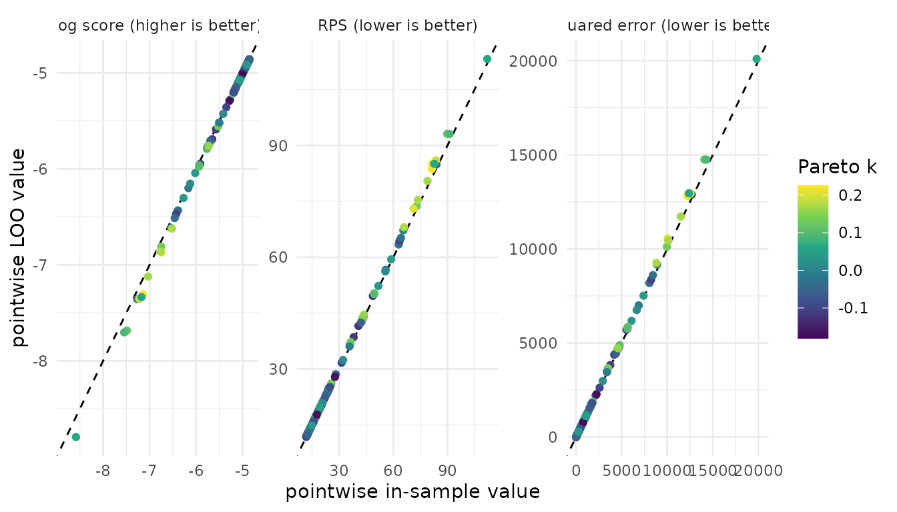
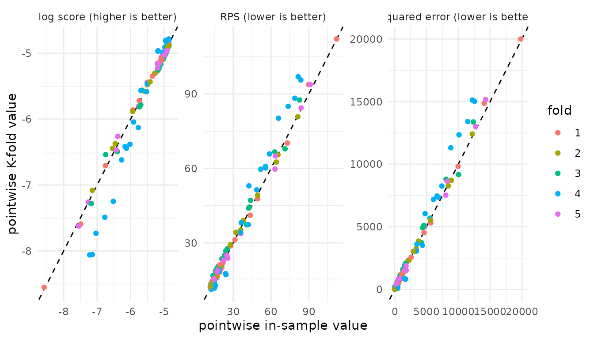
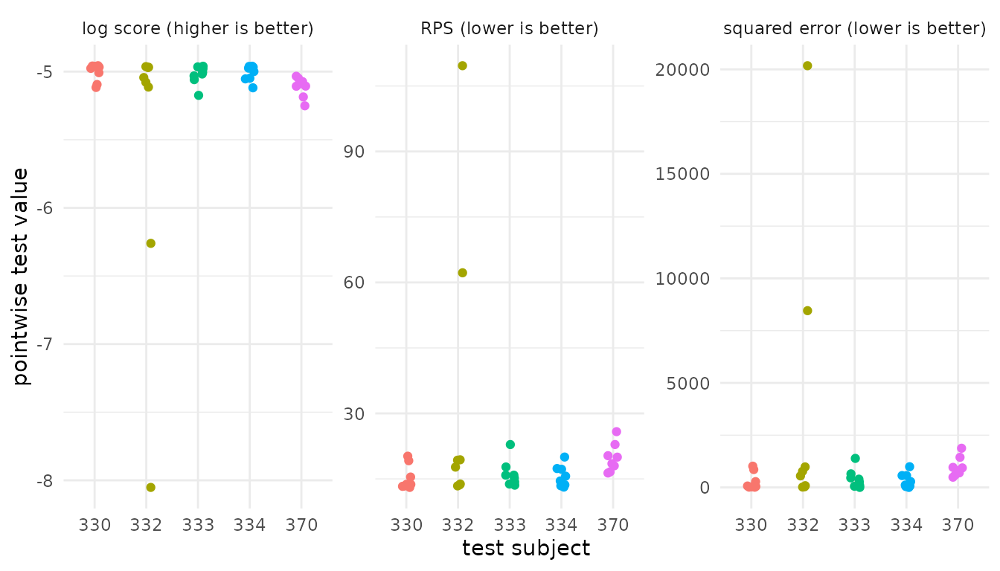
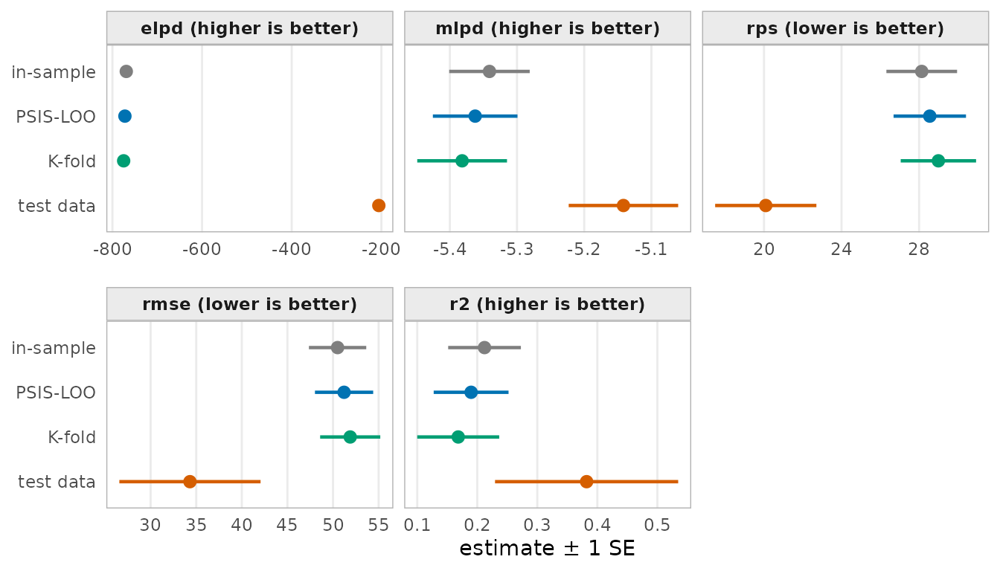

# Predictive model performance: Predictive schemes with \`pred_measure()\`

## Introduction

How well does a fitted model predict data that were not used to fit it?
The formula reference (Vehtari et al., 2026) divides this into three
questions:

1.  **What counts as a good prediction?** This is the *predictive
    measure*, for example the log score or the RMSE.
    - Discussed in the vignette [Predictive model performance: Overview
      of
      measures](https://mc-stan.org/loo/pr/363/articles/articles-online-only/overview-measures.md)
2.  **Which predictions are evaluated?** This is the *predictive
    scheme*. It sets the observations that train the model before
    observation \\i\\ is evaluated.
    - Focus of this vignette.
3.  **How are the predictions computed?** From posterior draws, from
    refits, or with importance weights.

**What this article does not cover**

- **Measure definitions**
  - See the [Predictive model performance: Overview of
    measures](https://mc-stan.org/loo/pr/363/articles/articles-online-only/overview-measures.md).
- **Model comparison**
  - See the [Model comparison: Explanation of
    `model_compare()`](https://mc-stan.org/loo/pr/363/articles/articles-online-only/model-comparison.md)
    vignette and
  - the [Model comparison case study: Uncertainty, scores, and
    predictive
    schemes](https://mc-stan.org/loo/pr/363/articles/articles-online-only/pred-measure-case-study.md)
- **Leave-one-group-out and leave-future-out schemes.**
  - Any reference?

### Training data and evaluation data

This vignette focuses on the predictive scheme. A predictive scheme is a
rule that splits the observed data \\y = (y_1, \ldots, y_n)\\ into a
training set \\\mathcal{T}\\ used to fit the model and an evaluation set
\\\mathcal{E}\\ (i.e., the observations whose predictive performance is
evaluated).

Predictive schemes include:

- the special case of *in-sample* evaluation, where the training and
  test set are the same, consisting of the full data set.
- *hold-out* evaluation, where the data set is split into two disjoint
  sets: one for training and one for evaluation.
- *cross-validation* schemes, where the training set is a subset of the
  data, and the evaluation set is the remaining data. For example, in
  leave-one-out cross-validation, the training set is the full data set
  minus one observation. In K-fold cross-validation, the training set is
  the full data set minus one of \\K\\ disjoint subsets of the data
  (i.e., the folds).

### Overview of the predictive schemes

The predictive measure API in the **loo** package has one entry point
for each predictive scheme:

| Scheme | Training data \\\mathcal{T}(i)\\ | Evaluation data \\\mathcal{E}\\ | Predictive distribution \\p^q(y_i)\\ | Weights \\w_i^s\\ | Entry point |
|:---|:---|:---|:---|:---|:---|
| [in-sample](#in-sample) | \\\\1, \ldots, n\\\\ | \\\\1, \ldots, n\\\\ | \\p(y_i \mid y)\\ | \\1/S\\ | [`insample_pred_measure()`](https://mc-stan.org/loo/pr/363/reference/insample_pred_measure.md) |
| [PSIS-LOO](#psis-loo)\* | \\\\1, \ldots, n\\ \setminus \\i\\\\ | \\\\1, \ldots, n\\\\ | \\p(y_i \mid y\_{-i})\\ | PSIS weights | [`loo_pred_measure()`](https://mc-stan.org/loo/pr/363/reference/loo_pred_measure.md) |
| [K-fold](#k-fold) | \\\\1, \ldots, n\\ \setminus \mathcal{I}\_{k(i)}\\ | \\\\1, \ldots, n\\\\ | \\p(y_i \mid y\_{-\mathcal{I}\_{k(i)}})\\ | \\1/S\\ | [`kfold_pred_measure()`](https://mc-stan.org/loo/pr/363/reference/kfold_pred_measure.md) |
| [test data](#test-data) | \\\mathcal{R}\\ | \\\mathcal{S}\\ | \\p(y_i \mid y\_{\mathcal{R}})\\ | \\1/S\\ | [`test_pred_measure()`](https://mc-stan.org/loo/pr/363/reference/test_pred_measure.md) |

For further discussion, see the paper [Predictive measures: A formula
reference](https://mc-stan.org/loo/pr/363/articles/articles-online-only/)
.

## Running example

**Prediction task.** The `sleepstudy` data (**lme4**) come from a study
of sleep restriction (Belenky et al., 2003). Eighteen subjects slept at
most three hours each night. The outcome `y` is the average reaction
time (ms) of a subject on one day. Days 0 and 1 were adaptation and
training, so this vignette keeps days 2 to 9. The predictor `Days`
counts the days of sleep restriction, from 0 to 7. This gives 144
observations.

``` r

library(loo)      # for evaluating the predictive performance
library(brms)     # for model fitting
library(lme4)     # for the sleepstudy data
library(ggplot2)  # for plotting

theme_set(theme_minimal())
SEED <- 42
```

To model the data, we use a normal regression of `y` on `Days` with no
subject effects. As fitting is not the focus of this vignette, we do not
discuss the modelling step in depth but show the code in the
[appendix](#appendix-model-code).

For discussing the different predictive schemes, we fit the model once
to the full data set and once to a subset of the data (i.e., the
training data). For the test data we holdout the observations of 5
subjects.

| Object      | Data                                  | Description          |
|:------------|:--------------------------------------|:---------------------|
| `fit_full`  | all 18 subjects, 144 observations     | fit to full data     |
| `fit_train` | 13 subjects, 104 observations         | fit to training data |
| `test_data` | the other 5 subjects, 40 observations | test data set        |

Each fit uses the `brms` default of 4 chains and 2000 iterations.

### Measures

To mesaure predictive performance of the model, we will use the
following measures: `elpd`, `mlpd`, `rps`, `rmse`, and `r2`. See the
vignette [Predictive model performance: Overview of
measures](https://mc-stan.org/loo/pr/363/articles/articles-online-only/overview-measures.md)
for a discussion of the measures.

Each measure requires one or more of the following inputs: the observed
values (`y`), the pointwise log predictive densities (`ylp`), the
predicted means (`mupred`), or draws from the predictive distribution
(`ypred`). The following table shows the required inputs for each
measure.

| Measure | `y` | `ylp` | `mupred` | `ypred` |
|:--------|:---:|:-----:|:--------:|:-------:|
| `elpd`  |     |   ✓   |          |         |
| `mlpd`  |     |   ✓   |          |         |
| `rps`   |  ✓  |       |          |    ✓    |
| `rmse`  |  ✓  |       |    ✓     |         |
| `r2`    |  ✓  |       |    ✓     |         |

To compute the corresponding inputs we use functions from `brms`.

``` r

measures <- c("elpd", "mlpd", "rps", "rmse", "r2")

y <- fit_full$data$y
ylp <- brms::log_lik(fit_full)
ypred <- brms::posterior_predict(fit_full)
mupred <- brms::posterior_epred(fit_full)
```

## Predictive schemes

### In-sample

We start the discussion with the special case of using in-sample
evaluations. In-sample performance evaluates the fitted model on the
same data used for fitting. It should not be used to estimate predictive
performance. Nevertheless, it can be useful as a reference point, and
the amount of optimism relative to a cross-validation or test-data
estimate can itself be informative.

**Implementation**

``` r

insample_sleep <- insample_pred_measure(
  y = y,
  ypred = ypred,
  mupred = mupred,
  ylp = ylp,
  measures = measures
)
str(insample_sleep)
#> List of 2
#>  $ estimates: num [1:5, 1:2] -769.107 -5.341 28.136 50.501 0.212 ...
#>   ..- attr(*, "dimnames")=List of 2
#>   .. ..$ : chr [1:5] "elpd" "mlpd" "rps" "rmse" ...
#>   .. ..$ : chr [1:2] "Estimate" "SE"
#>  $ pointwise: num [1:144, 1:5] -4.91 -5.2 -5.7 -7.27 -5.76 ...
#>   ..- attr(*, "dimnames")=List of 2
#>   .. ..$ : NULL
#>   .. ..$ : chr [1:5] "elpd" "mlpd" "rps" "rmse" ...
#>  - attr(*, "measure_info")=List of 5
#>   ..$ elpd:List of 3
#>   .. ..$ loss       : logi FALSE
#>   .. ..$ diff_method: chr "sum"
#>   .. ..$ se_diff_fun: NULL
#>   ..$ mlpd:List of 3
#>   .. ..$ loss       : logi FALSE
#>   .. ..$ diff_method: chr "mean"
#>   .. ..$ se_diff_fun: NULL
#>   ..$ rps :List of 3
#>   .. ..$ loss       : logi TRUE
#>   .. ..$ diff_method: chr "mean"
#>   .. ..$ se_diff_fun: NULL
#>   ..$ rmse:List of 3
#>   .. ..$ loss       : logi TRUE
#>   .. ..$ diff_method: chr "measure_specific"
#>   .. ..$ se_diff_fun: chr "rmse"
#>   ..$ r2  :List of 4
#>   .. ..$ loss       : logi FALSE
#>   .. ..$ diff_method: chr "measure_specific"
#>   .. ..$ se_diff_fun: chr "r2"
#>   .. ..$ extra      :List of 1
#>   .. .. ..$ mse_y_i: num [1:144] 3271 181 2387 11385 5507 ...
#>  - attr(*, "dims")= int [1:2] 4000 144
#>  - attr(*, "class")= chr [1:2] "insample_pred_measure" "pred_measure"
#>  - attr(*, "source")= chr "insample"
```

**Result** The returned structure of the `pred_measure` class includes
the `$estimates` and `$pointwise` components per selected measure.
Furthermore, the following attributes are included in the result:

- `measure_info`: a list with entries for each measure with respective
  additional information
- `dims`: provides the dimensions of the data used for evaluation.
- `class`: indicates the class of the result, here `"pred_measure"` and
  `"insample_pred_measure"`.
- `source`: indicates the predictive scheme used, here `"insample"`.

The corresponding print method shows the estimates and standard errors
for each measure, as well as the number of observations used for
evaluation.

``` r

insample_sleep
#> 
#> Computed from 4000 posterior draws and 144 observations.
#> Data source: in-sample
#> 
#>      Estimate     SE
#> elpd   -769.1    8.6
#> mlpd   -5.341  0.060
#> rps      28.1    1.8
#> rmse     50.5    3.1
#> r2      0.212  0.061
```

### PSIS-LOO

Next, we focus on the leave-one-out cross-validation (LOO) scheme,
specifically using Pareto-smoothed importance sampling (PSIS) to
approximate the LOO predictive performance. While exact leave-one-out
cross-validation needs one refit for each observation, PSIS-LOO uses the
draws of the full-data fit instead. PSIS-LOO then weights the draws with
Pareto-smoothed importance weights, so that each \\y_i\\ is scored as if
it was left out (Vehtari et al., 2024).

**Implementation** We first compute the PSIS-LOO object using
[`brms::loo()`](https://mc-stan.org/loo/reference/loo.html) and then
pass it to
[`loo_pred_measure()`](https://mc-stan.org/loo/pr/363/reference/loo_pred_measure.md).
Otherwise, the input structure is the same as for the in-sample
evaluation.

``` r

loo_sleep <- brms::loo(fit_full, save_psis = TRUE)

loo_sleep_measure <- loo_pred_measure(
  loo = loo_sleep,
  y = y,
  ypred = ypred,
  mupred = mupred,
  measures = measures
)
loo_sleep_measure
#> 
#> Computed from 4000 posterior draws and 144 observations.
#> Data source: loo
#> 
#>          Estimate     SE
#> elpd_loo   -772.2    9.1
#> p_loo         3.1    0.5
#> mlpd_loo   -5.362  0.063
#> rps_loo      28.6    1.9
#> rmse_loo     51.2    3.2
#> r2_loo      0.190  0.062
#> ------
#> 
#> All Pareto k estimates are good (k < 0.7).
```

**Result** Compared to the in-sample evaluation, the rows now have the
suffix `_loo`. The measure `elpd` also adds automatically `p_loo`, the
difference between the in-sample and the LOO log score (Vehtari et al.,
2026).

The output structure of the `loo_pred_measure` class includes two
additional components compared to the `insample_pred_measure` class:

- `$diagnostics`: including `pareto_k`, the Pareto \\\hat k\\ values for
  each observation, and (relative) effective sample size, `n_eff` and
  `r_eff`.
- `$log_weights`: the log PSIS weights.

``` r

names(loo_sleep_measure)
#> [1] "estimates"   "pointwise"   "diagnostics" "log_weights"
```

**Plot** The following plot compares the in-sample and LOO scores for
three measures: the log score, the RPS, and the squared error. Each
point is one observation. The x-axis shows the in-sample value, and the
y-axis the LOO value. The color shows the Pareto \\\hat k\\. We do not
show `mlpd` and `r2` as their pointwise values are the same as those of
`elpd` and `rmse`.



The log score is a utility (higher is better). The RPS and the squared
error are losses (lower is better). Thus, an observation that is harder
to predict when it is left out lies below the diagonal for the log
score, but above the diagonal for the RPS and the squared error. The
farther a point lies from the diagonal, the more the observation
influences the posterior. Such observations often have a high Pareto
\\\hat k\\. The color lets you check whether an influential observation
moves away from the diagonal for all measures or only for some.

### K-fold

Next, we focus on K-fold cross-validation. The data are split into \\K\\
folds. The model is fit once for each fold, without the observations in
that fold. This needs \\K\\ fits, not \\n\\.

**Implementation** The **loo** package does not refit the model but this
can be done with
[`brms::kfold()`](https://mc-stan.org/loo/reference/kfold-generic.html).
Set `save_fits = TRUE`. Without the fits,
[`brms::kfold_predict()`](https://paulbuerkner.com/brms/reference/kfold_predict.html)
cannot compute the held-out draws: `method = "predict"` gives `ypred`,
and `method = "fitted"` gives `mupred`.

``` r

set.seed(SEED)
kfold_sleep <- brms::kfold(fit_full, K = 5, save_fits = TRUE)
ypred_kfold <- brms::kfold_predict(kfold_sleep, method = "predict")$yrep
mupred_kfold <- brms::kfold_predict(kfold_sleep, method = "fitted")$yrep
```

We then pass the K-fold object to
[`kfold_pred_measure()`](https://mc-stan.org/loo/pr/363/reference/kfold_pred_measure.md).
Otherwise, the input structure is the same as for the previous examples.

``` r

kfold_sleep_measure <- kfold_pred_measure(
  y = y,
  ypred = ypred_kfold,
  mupred = mupred_kfold,
  kfold = kfold_sleep,
  measures = measures
)
kfold_sleep_measure
#> 
#> Computed from 4000 posterior draws and 144 observations.
#> Data source: k-fold
#> 
#>            Estimate     SE
#> elpd_kfold   -775.0    9.6
#> p_kfold         5.9    2.0
#> mlpd_kfold   -5.382  0.067
#> rps_kfold      29.0    1.9
#> rmse_kfold     51.9    3.3
#> r2_kfold      0.168  0.068
```

**Result** The rows in the result object now have the suffix `_kfold`.
The measure `elpd` also adds `p_kfold`, the difference between the
in-sample and the K-fold log score.

The output structure of the `kfold_pred_measure` class copies the
attributes `K`, `folds`, `fold_type`, `joint`, `yhash`, and `model_name`
from the `kfold` object. It has `$diagnostics` only when the `kfold`
object has them. K-fold uses no importance weights, so there is no
`$log_weights` component as in the case of PSIS-LOO.

``` r

names(kfold_sleep_measure)
#> [1] "estimates"   "pointwise"   "diagnostics"
```

**Plot** The following plot compares the in-sample and K-fold values for
the three measures. Each point is one observation. The color shows the
fold of each observation.



The direction of the diagonal is the same as in the PSIS-LOO plot. With
\\K = 5\\, each fit uses about 80% of the data. Thus K-fold and PSIS-LOO
answer a similar question. Each K-fold fit has less data than a LOO fit,
so the K-fold estimates are often slightly worse.

[`brms::kfold()`](https://mc-stan.org/loo/reference/kfold-generic.html)
also accepts `folds = "grouped"` with `group = "Subject"`. Then each
fold holds out whole subjects, and the predictive question changes to
new subjects.

### Test data

Finally, we focus on the test data scheme, where the data is split into
two disjoint sets, a training and a test set. The model is fit only to
the training set. It then predicts the test set, which it did not see.
For the current example, we hold out five subjects. This gives 40 test
observations.

**Implementation** We compute the draws of `fit_train` at `test_data`
with `newdata`. Pass the log densities of the test observations as
`ylp_test`, not as `ylp`. The measures `elpd`, `mlpd`, and `ic` need
`ylp_test`.

``` r

ypred_test <- brms::posterior_predict(fit_train, newdata = test_data)
mupred_test <- brms::posterior_epred(fit_train, newdata = test_data)
ylp_test <- brms::log_lik(fit_train, newdata = test_data)

test_sleep_measure <- test_pred_measure(
  y = test_data$y,
  ypred = ypred_test,
  mupred = mupred_test,
  ylp_test = ylp_test,
  measures = measures
)
test_sleep_measure
#> 
#> Computed from 4000 posterior draws and 40 observations.
#> Data source: test
#> 
#>           Estimate     SE
#> elpd_test   -205.7    3.3
#> mlpd_test   -5.142  0.081
#> rps_test      20.1    2.6
#> rmse_test     34.3    7.7
#> r2_test      0.382  0.153
```

**Result** The rows in the result object now have the suffix `_test`.
The attribute `dims` gives the size of the test set, 40 observations,
not the size of the training set. The output has only `$estimates` and
`$pointwise`.

``` r

names(test_sleep_measure)
#> [1] "estimates" "pointwise"
```

**Plot** The test observations are not in the training data. Thus there
is no in-sample value. The following plot shows the pointwise test
values on the y-axis for each of the five test subjects on the x-axis.



The test set holds five subjects that the model did not see. The plot
shows whether one subject controls the estimate. The test set is small,
so the standard errors are larger than in the other schemes. A different
split can give a different estimate.

## Comparison of predictive schemes

All four schemes use the same model and the same measures. They differ
in the predictive question. The plot shows the estimate and \\\pm 1\\
standard error for each scheme and measure.

`elpd` is a sum over the evaluation data (Vehtari et al., 2026, Eq.
2.7). The test set has 40 observations, and the other schemes have 144.
Thus do not compare the `elpd` of the test data with the other schemes.
Use `mlpd` for this comparison.



In-sample, PSIS-LOO, and K-fold score the same 144 observations. The
in-sample estimate is the most optimistic, because the model has seen
each \\y_i\\. PSIS-LOO and K-fold ask a similar question, so their
estimates are close. The test data score five new subjects. The interval
of the test data is wider, because the test set has only 40
observations. One split is noisy. A different split can move the
estimate to the other side of PSIS-LOO.

## Add measures to an existing result

Besides the four scheme functions, the
[`pred_measure()`](https://mc-stan.org/loo/pr/363/reference/pred_measure.md)
function adds measures to an object of class `pred_measure`. It takes
the predictive scheme from the result, for example `kfold`, and adds new
measures to the result object. If a requested measure is already stored,
[`pred_measure()`](https://mc-stan.org/loo/pr/363/reference/pred_measure.md)
warns and skips it.

For example, we first compute only `elpd` with PSIS-LOO.

``` r

loo_elpd <- loo_pred_measure(
  loo = loo_sleep, measures = "elpd", save_psis = TRUE
)
loo_elpd
#> 
#> Computed from 4000 posterior draws and 144 observations.
#> Data source: loo
#> 
#>          Estimate     SE
#> elpd_loo   -772.2    9.1
#> p_loo         3.1    0.5
#> ------
#> 
#> All Pareto k estimates are good (k < 0.7).
```

And decide then that we want to add further measures to the output. We
can do that using
[`pred_measure()`](https://mc-stan.org/loo/pr/363/reference/pred_measure.md)
and provide the additional measures with their required input:

``` r

pred_measure(
  y = y,
  mupred = mupred,
  predperf = loo_elpd,
  measures = c("mae", "rmse")
)
#> 
#> Computed from 4000 posterior draws and 144 observations.
#> Data source: loo
#> 
#>          Estimate     SE
#> elpd_loo   -772.2    9.1
#> p_loo         3.1    0.5
#> mae_loo      39.1    2.8
#> rmse_loo     51.2    3.2
#> ------
#> 
#> All Pareto k estimates are good (k < 0.7).
```

## Custom measures

The argument `measures` also accepts functions. Use them to define
custom measures. A custom function must follow three rules:

- **Arguments.** Name the arguments from `y`, `ypred`, `mupred`, `ylp`,
  and `log_weights`. **loo** maps the inputs by these names.
- **Weights.** `log_weights` holds the PSIS weights for PSIS-LOO. In the
  other schemes it is `NULL`. A function that ignores `log_weights`
  gives in-sample values under PSIS-LOO.
- **Return value.** Return a list with `estimate`, `se`, and
  `pointwise`.

After you construct the custom function, wrap it in
[`custom_measure()`](https://mc-stan.org/loo/pr/363/reference/custom_measure.md),
which sets the name, whether the measure is a loss (lower is better) or
a utility, and how
[`model_compare()`](https://mc-stan.org/loo/pr/363/reference/model_compare.md)
computes the standard error of a difference (`se_diff_fun`). The default
is a utility (higher is better). If you do not give `se_diff_fun`,
[`model_compare()`](https://mc-stan.org/loo/pr/363/reference/model_compare.md)
reports an `NA` standard error.

**Example.** The coverage of the central 90% predictive interval is the
proportion of observations inside that interval. For a calibrated model,
it is close to 0.9. Observation \\i\\ is inside the interval when its
probability integral transform lies between 0.05 and 0.95:

\\ \text{pit}\_i = \sum\_{s=1}^S w_i^s\\ \mathbb{1}\\\tilde y_i^s \le
y_i\\, \qquad \text{cover}\_i = \mathbb{1}\\0.05 \< \text{pit}\_i \le
0.95\\ . \\

``` r

coverage <- function(y, ypred, log_weights = NULL, prob = 0.9) {
  if (is.null(log_weights)) {
    log_weights <- matrix(-log(nrow(ypred)), nrow(ypred), ncol(ypred))
  }
  w <- exp(sweep(log_weights, 2, matrixStats::colLogSumExps(log_weights)))
  pit <- colSums(w * sweep(ypred, 2, y, "<="))
  alpha <- 1 - prob
  cover_i <- as.numeric(pit > alpha / 2 & pit <= 1 - alpha / 2)
  list(
    estimate = mean(cover_i),
    se = sqrt(var(cover_i) / length(cover_i)),
    pointwise = cover_i
  )
}
```

The same function works in every scheme:

``` r

cover90 <- custom_measure(coverage, name = "cover90", se_diff_fun = "mean")

insample_pred_measure(
  y = y,
  ypred = ypred,
  measures = list("rps", cover90 = cover90)
)
#> 
#> Data source: in-sample
#> 
#>         Estimate    SE
#> rps         28.1   1.8
#> cover90    0.868 0.028

loo_pred_measure(
  loo = loo_sleep,
  y = y,
  ypred = ypred,
  measures = list("rps", cover90 = cover90)
)
#> 
#> Computed from 4000 posterior draws and 144 observations.
#> Data source: loo
#> 
#>             Estimate    SE
#> rps_loo         28.6   1.9
#> cover90_loo    0.868 0.028
#> ------
#> 
#> All Pareto k estimates are good (k < 0.7).
```

## References

Belenky, G., Wesensten, N. J., Thorne, D. R., et al. (2003). Patterns of
performance degradation and restoration during sleep restriction and
subsequent recovery: A sleep dose-response study. *Journal of Sleep
Research*, 12(1):1–12.

Paananen, T., Piironen, J., Bürkner, P.-C., and Vehtari, A. (2021).
Implicitly adaptive importance sampling. *Statistics and Computing*,
31(2):16.

Silva, L. and Zanella, G. (2022). Robust leave-one-out cross-validation
for high-dimensional Bayesian models. Preprint at
[arXiv:2209.09190](https://arxiv.org/abs/2209.09190).

Vehtari, A., Axen, S., Weber, F., and Bockting, F. (2026). Predictive
measures and model comparison in the loo package: A formula reference.
\[TODO: arXiv ID\]

Vehtari, A., Gelman, A., and Gabry, J. (2017). Practical Bayesian model
evaluation using leave-one-out cross-validation and WAIC. *Statistics
and Computing*, 27(5):1413–1432. <doi:10.1007/s11222-016-9696-4>

Vehtari, A., Simpson, D., Gelman, A., Yao, Y., and Gabry, J. (2024).
Pareto smoothed importance sampling. *Journal of Machine Learning
Research*, 25(72):1–58.

## See also

- [Predictive model performance: Overview of
  measures](https://mc-stan.org/loo/pr/363/articles/articles-online-only/overview-measures.md)
- [Model comparison: Explanation of
  `model_compare()`](https://mc-stan.org/loo/pr/363/articles/articles-online-only/model-comparison.md)
- [Cross-validation FAQ](https://users.aalto.fi/~ave/CV-FAQ.html)

## Appendix: model code

``` r

set.seed(SEED)

data("sleepstudy", package = "lme4")
sleepstudy <- subset(sleepstudy, Days >= 2)
sleepstudy$Days <- sleepstudy$Days - 2
sleepstudy$y <- sleepstudy$Reaction

prior_sleep <- brms::prior(normal(200, 100), class = b, coef = "Intercept") +
  brms::prior(normal(0, 20), class = b, coef = "Days") +
  brms::prior(exponential(0.02), class = sigma)

# all subjects
fit_full <- brms::brm(
  y ~ 0 + Intercept + Days,
  data = sleepstudy,
  family = gaussian(),
  prior = prior_sleep,
  seed = SEED,
  refresh = 0
)

# five subjects held out as test data
test_subjects <- sample(unique(sleepstudy$Subject), size = 5)
train_data <- subset(sleepstudy, !Subject %in% test_subjects)
test_data <- subset(sleepstudy, Subject %in% test_subjects)

fit_train <- update(
  fit_full, newdata = train_data, seed = SEED, refresh = 0
)
```
